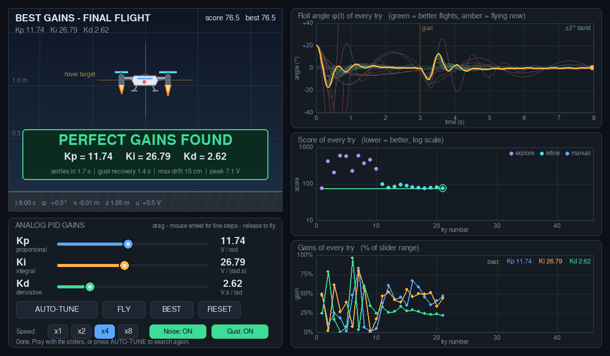
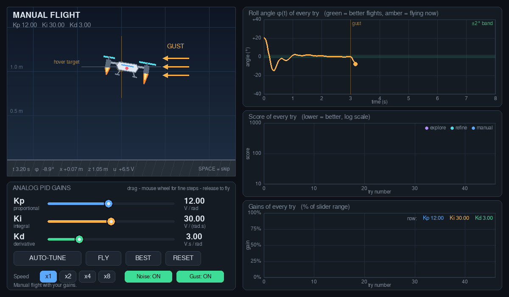
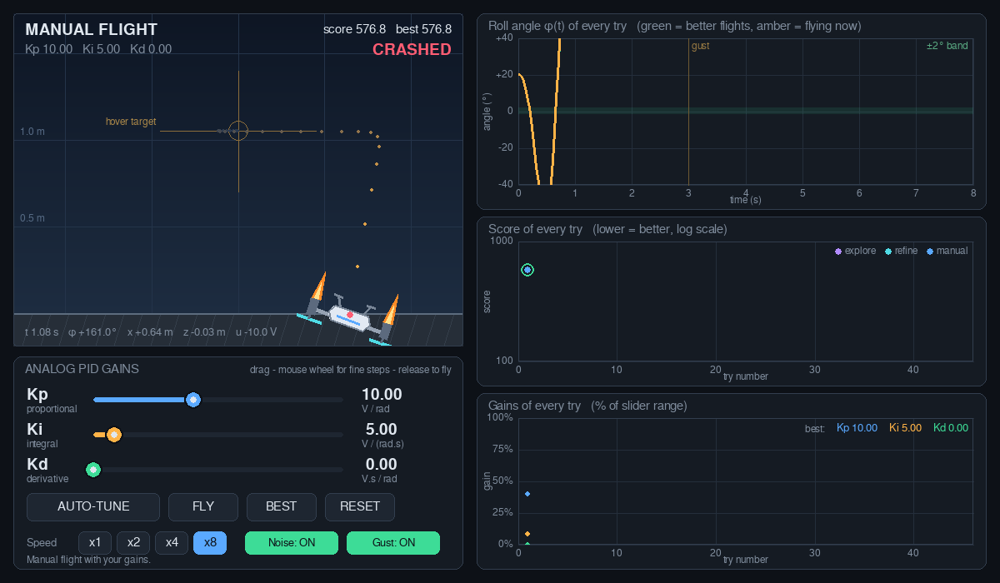

# AI-generated Python codes demonstrating interactively the roles of the analog PID gains in stability

An interactive Python simulation of a 2D drone that has to hover while an **analog PID corrector** (proportional, integral and derivative branches, as in my TIPE circuit) holds its roll angle. You drag the three gains **Kp, Ki, Kd** and watch, on the same window, what each one does to the flight: speed, damping, drift, noise and loss of stability. An automatic search can also hunt for a good set of gains and show every attempt.

> **Context.** This comes from my TIPE project *"Stabilisation d'un drone quadricoptère par une boucle PID"* (theme: cycles, boucles). The analog circuit in that project was analysed and simulated, **never built physically**. This repository is a simulation of the idea, not a test of real hardware.

> **Authorship.** The code in this repository was **generated by an AI assistant (Claude, by Anthropic)** from specifications I gave it. The assistant ran it headlessly (no physical window) and produced the measurements quoted below. *[Author: add here what you checked or changed yourself.]*



## What it shows

One window, drone on the left, graphs on the right:

| Area | Content |
|---|---|
| Drone view | The drone flying each try, with a target cross, a trail, rotor flames that follow the motor commands, and a GUST arrow when the wind hits |
| Sliders | **Kp, Ki, Kd.** Drag, then release to fly. The mouse wheel gives fine steps |
| Graph 1 | Roll angle φ(t) of every try (red = worse, green = better), the current flight in amber |
| Graph 2 | Score of every try, with the best so far (log scale, lower is better) |
| Graph 3 | Kp, Ki, Kd of every try, to see how the search moves toward the best gains |

| Control | What it does |
|---|---|
| **AUTO-TUNE** / STOP | Starts from the current sliders, tries gain sets automatically (the sliders move by themselves), then flies the best one slowly |
| **FLY** | Flies the current slider values again |
| **BEST** | Loads the last best gains (saved in `best_gains.json`) |
| **RESET** | Clears the history and returns to the starting gains |
| **Speed x1 to x8** | Playback speed of each flight |
| **Noise / Gust** | Switch sensor noise and the wind gust on or off |
| `SPACE` | Skip the current flight |



## Quick start

```
pip install -r requirements.txt
python drone_pid_tuner.py
```

Only `pygame` (here `pygame-ce`) is needed. Tested headlessly with pygame-ce 2.5.8 on Python 3.13.

## The model

The roll angle follows the master equation of the analog loop:

$$\ddot\varphi = k\,u(t), \qquad u = K_p\,e + K_i\!\int e\,dt + K_d\,\frac{de}{dt}, \qquad e = \varphi_{ref}-\varphi, \qquad k=\frac{k_u}{I_x}$$

so that, for a reference of 0, the closed loop is

$$\ddot\varphi + kK_d\,\dot\varphi + kK_p\,\varphi + kK_i\!\int\varphi\,d\tau = 0
\;\;\Longleftrightarrow\;\; s^3 + kK_d\,s^2 + kK_p\,s + kK_i = 0 .$$

For this ideal loop, the Routh-Hurwitz condition gives stability when all gains are positive and

$$k\,K_d\,K_p > K_i .$$

With the gains found in the example below, `k·Kd·Kp / Ki ≈ 6.9`, so the ideal loop is comfortably stable. The simulation then adds the effects that erode this margin in a real circuit:

- **Saturation** of the summing amplifier and the integrator (±10 V).
- **Differentiator roll-off** (15 ms), as in a real analog differentiator.
- **Motor and propeller lag** (60 ms).
- **Sensor noise** on φ, which the derivative branch amplifies.
- **A constant disturbance torque** (unbalanced motors), which only the integral branch can cancel.

Every try uses the same scenario so that tries are comparable: the drone starts tilted by 20°, recovers, is hit by a wind gust at 3 s, and recovers again. The noise sequence is fixed.

**What is not your analog circuit.** To make the drone hover, two simple *fixed* outer loops turn position errors into a reference angle (lateral position) and a total thrust (altitude). The PID under study is the inner loop that makes φ follow its reference. The drone is planar (2D) with no aerodynamics.

## What each gain does (measured in this simulation)

One gain changes at a time, the other two stay at the example best values (Kp 11.74, Ki 26.79, Kd 2.62). Score: lower is better.

**Kp, the stiffness.** Too low is slow and drifts, too high saturates and oscillates.

| Kp | Score | Outcome |
|---|---|---|
| 2 | 272 | slow: 3.0 s to settle, 35 cm drift |
| 5 | 119 | 2.3 s to settle |
| 8 | 80 | 1.6 s to settle |
| **11.74** | **76.5** | best |
| 18 | 183 | hits the 10 V limit, 3.0 s to settle |
| 25 | 543 | flies away |

**Ki, the memory.** It removes the offset caused by the constant disturbance. Too much costs margin and effort.

| Ki | Score | Max drift | Offset at the end |
|---|---|---|---|
| 0 | 94 | 52 cm | **37.9 cm** (settles off target) |
| 5 | 85 | 37 cm | 1.6 cm |
| 15 | 81 | 22 cm | 4.2 cm |
| **26.79** | **76.5** | 15 cm | 2.1 cm |
| 45 | 80 | 12 cm | 1.1 cm |
| 60 | 100 | 11 cm | 0.8 cm (peak command 8.7 V, less margin) |

**Kd, the damping.** Without it the loop is not stable. Too much amplifies noise.

| Kd | Score | Outcome |
|---|---|---|
| 0 | 590 | flies away |
| 0.5 | 579 | crashes |
| 1 | 573 | flies away |
| **2.62** | **76.5** | best (control jitter 28) |
| 6 | 125 | control jitter 61 |
| 12 | 240 | control jitter 119, saturates |



These numbers describe **this model with its assumed parameters**. They illustrate the roles of the gains, not laws for a physical circuit.

## The automatic search

1. Try 1 uses the current slider values.
2. Nine more tries explore the gain space with a Latin-hypercube sample.
3. A (1+1) evolution strategy then mutates the best gains found so far, widening its step after an improvement and shrinking it otherwise.
4. It stops after 45 tries, or earlier when the best score improves by less than 0.5 % over 12 tries and the step has become small. The best gains are then flown slowly and shown on screen.

With the default parameters it found about **Kp 11.7, Ki 26.8, Kd 2.6** (score 76.5; an earlier coarse brute-force grid search found about 72). The label "perfect" on screen means *the lowest score under the weights in the code* plus a few checks (settles within 1.8 s, recovers from the gust within 1.8 s, final position error below 5 cm, almost no saturation). It is not a proof of optimality.

## Make it match your own circuit

Everything adjustable is in **section 1** of `drone_pid_tuner.py`:

| Constant | Meaning |
|---|---|
| `K_PLANT` | k = k_u / I_x of your dossier (assumed 6 rad/s² per volt) |
| `V_SAT` | saturation voltage of the summing amplifier |
| `TAU_MOTOR`, `TAU_D`, `NOISE_STD`, `BIAS_ACC` | motor lag, differentiator roll-off, sensor noise, constant disturbance |
| `W_ANG`, `W_POS`, `W_EFF`, `W_JIT`, `W_SAT` | weights of the score |
| `KP_RANGE`, `KI_RANGE`, `KD_RANGE` | slider and search ranges |

The values are **assumptions, not measurements of a real circuit**. Translating Kp, Ki, Kd into resistor, capacitor and multiplier values depends on the exact topology and is not done here.

## Limitations

- Simulation only: the analog circuit was never built.
- The plant parameters are assumed, so the gains found are specific to this model.
- Planar drone, ideal sensors apart from the noise term, no aerodynamic damping, no battery effects.
- The outer position and altitude loops are an addition and are not part of the analog PID.
- Tested without a physical display. If the window looks wrong on your machine, please open an issue.

## Repository contents

```
drone_pid_tuner.py      the interactive simulator and auto-tuner (single file)
requirements.txt        pygame-ce
docs/                   screenshots used in this README
```

## License

*[Author: choose a license and add a `LICENSE` file, for example MIT.]*

## Acknowledgements

Code written with Claude (Anthropic). The physical model follows the notation of my TIPE dossier.
